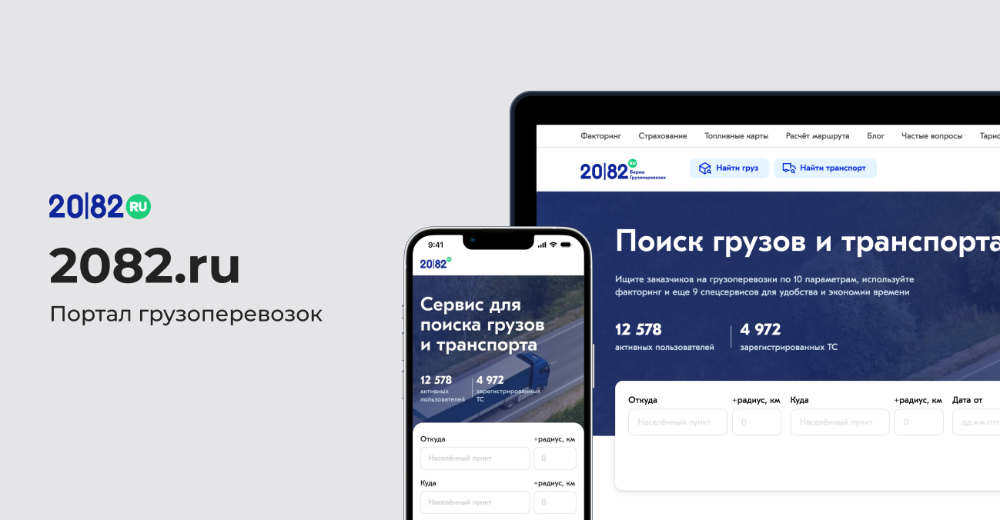
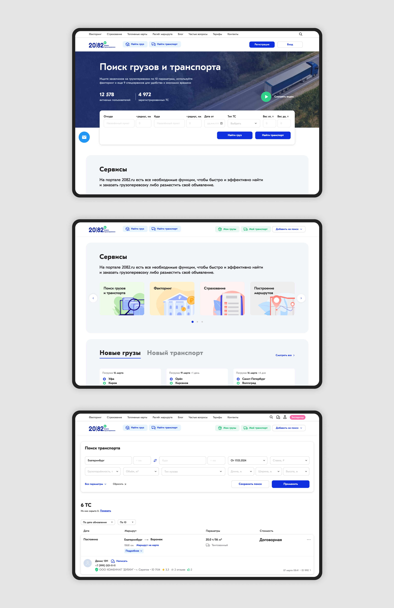
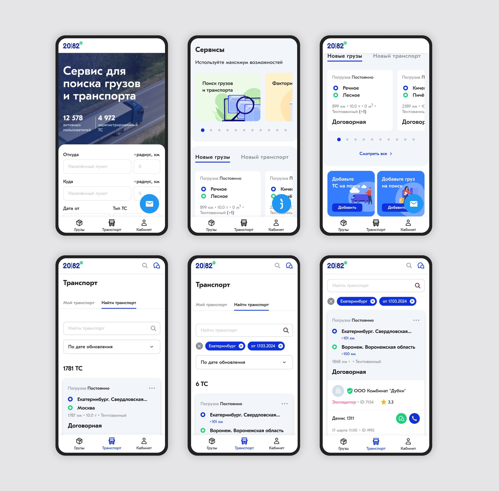

← [Назад к резюме и списку проектов](../README.md)

# 2082.ru
**2022-2024**

[2082.ru](https://2082.ru/)  
UI/UX, WEB, e-commerce, Logistics, PWA

## О проекте
2082.ru — B2B-платформа в сфере автомобильных грузоперевозок, где перевозчики размещают свободный транспорт, а грузовладельцы — грузы для перевозки. Пользователи сервиса могут искать подходящие предложения, взаимодействовать друг с другом, обмениваться документами и управлять рабочими процессами внутри платформы.

Когда я подключилась к проекту, продукт уже имел большую аудиторию и сложную бизнес-логику, однако интерфейс был перегружен визуально и функционально. Пользователям было трудно ориентироваться в большом количестве данных, а мобильная версия не закрывала реальные сценарии работы «в полях».

Основная задача проекта заключалась не просто в редизайне интерфейса, а в переосмыслении UX крупного B2B-сервиса с большим количеством ролей, сценариев и data-heavy интерфейсов.

**Основные функции платформы:**
* поиск грузов и транспорта
* публикация объявлений
* управление грузами, транспортом и водителями
* документооборот
* встроенный meссенджер
* страхование грузов и транспорта
* управление тарифами и подписками
* личные кабинеты перевозчиков, экспедиторов и грузовладельцев
* мобильная PWA-версия платформы

---

## Что делала

### — UX/UI редизайн платформы
На проекте я занималась комплексным развитием продукта: от переработки UX и визуальной системы до проектирования новых сервисов и мобильной PWA-версии.

Перед началом проектирования я провела аудит существующего интерфейса и выделила ключевые проблемы продукта:
* перегруженная визуальная структура;
* отсутствие чёткой иерархии действий;
* сложная навигация;
* большое количество однотипных элементов;
* слабая адаптация под мобильные сценарии;
* перегруженные data-heavy интерфейсы.

Основная сложность проекта заключалась в том, что платформа содержала большое количество сущностей и ролей: грузы, transport, водители, документы, тарифы, страховки, сообщения, компании и т.д. Пользователи ежедневно работали с большим объёмом информации, поэтому интерфейс должен был помогать быстро принимать решения, а не усложнять работу.

В процессе редизайна я:
* переработала структуру личных кабинетов;
* упростила навигацию между разделами;
* пересобрала карточки грузов и транспорта с акцентом на ключевые параметры (маршрут, стоимость, сроки);
* переработала таблицы, фильтры и поисковые сценарии;
* внедрила визуальную иерархию действий;
* уменьшила визуальный шум и повысила читаемость интерфейсов;
* оптимизировала пользовательские сценарии публикации и поиска объявлений.

Отдельное внимание уделялось мобильным сценариям. Значительная часть аудитории пользовалась платформой прямо во время перевозок, поэтому важно было адаптировать сложный B2B-функционал под использование «на ходу».

### — Проектирование новых сервисов
Помимо редизайна существующих интерфейсов я проектировала новые продуктовые направления внутри платформы.

Для сервиса были разработаны:
* встроенный мессенджер между пользователями;
* система документооборота;
* сервис страхования грузов и транспорта;
* гибкая тарифная система;
* новые сценарии работы с водителями и транспортом;
* расширенные личные кабинеты компаний.

Особенно сложной задачей стало проектирование документооборота и связей между сущностями внутри системы. Например, пользователям нужно было быстро понимать, какие документы относятся к конкретному транспорту, водителю или грузу, а также управлять доступами для разных ролей.

Для этого была разработана более прозрачная структура хранения и отображения данных, а интерфейсы стали модульными и легче масштабировались под новые сценарии.

### — Разработка мобильной PWA-версии
Одним из крупных направлений проекта стала разработка полноценной мобильной PWA-версии платформы.

Это был не просто адаптивный сайт, а фактически отдельный мобильный продукт со своими UX-паттернами и ограничениями. Необходимо было сохранить весь основной функционал платформы, при этом сделать интерфейс удобным для использования с телефона.

В рамках мобильной версии были переработаны:
* навигация;
* карточки грузов и транспорта;
* фильтры и поиск;
* сценарии общения между пользователями;
* формы публикации объявлений;
* уведомления и быстрые действия.

Главной задачей было сократить количество действий в критически важных сценариях и сделать работу с платформой быстрой даже при нестабильном интернете и использовании «в дороге».

### — Разработка UI-kit и систематизация интерфейсов
На старте проекта интерфейсы развивались несистемно: многие элементы дублировались, компоненты отличались между разделами, а поддержка продукта постепенно усложнялась.

Я разработала UI-kit и систематизировала компонентную базу платформы:
* унифицировала кнопки, формы, таблицы и карточки;
* стандартизировала состояния и поведение элементов;
* оптимизировала структуру макетов;
* автоматизировала повторяющиеся компоненты;
* подготовила основу для дальнейшего масштабирования продукта.

Это позволило ускорить дальнейшую разработку новых функций и значительно упростило коммуникацию с разработчиками.

---

## В итоге
В результате проект превратился из перегруженного и визуально устаревшего сервиса в полноцененную современную B2B-платформу с более понятным UX и масштабируемой архитектурой интерфейсов.

Пользователям стало проще:
* искать грузы и транспорт;
* ориентироваться в большом объёме данных;
* взаимодействовать друг с другом;
* работать с документами и дополнительными сервисами;
* пользоваться платформой с мобильных устройств.

Для бизнеса редизайн стал основой дальнейшего развития продукта: платформа получила новые сервисы, улучшенную мобильную версию и более устойчивую дизайн-систему, которая позволила быстрее запускать новые функции и масштабировать продукт дальше.

---

## Экраны

---
← [Назад к резюме и списку проектов](../README.md)
