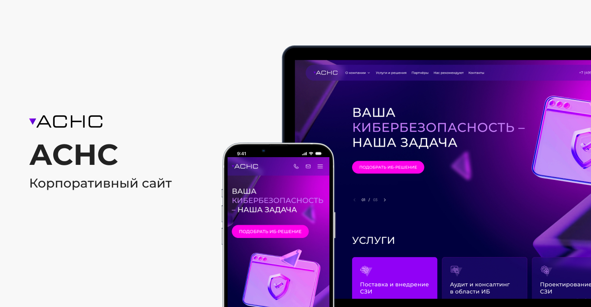
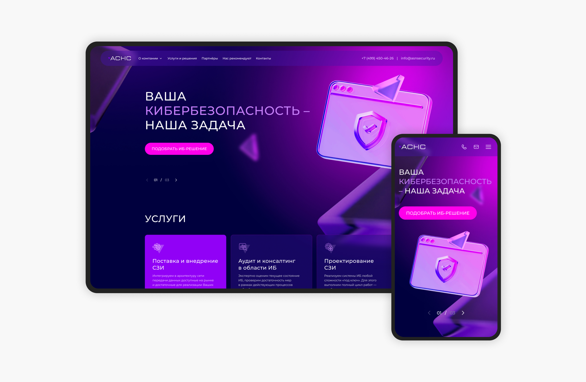
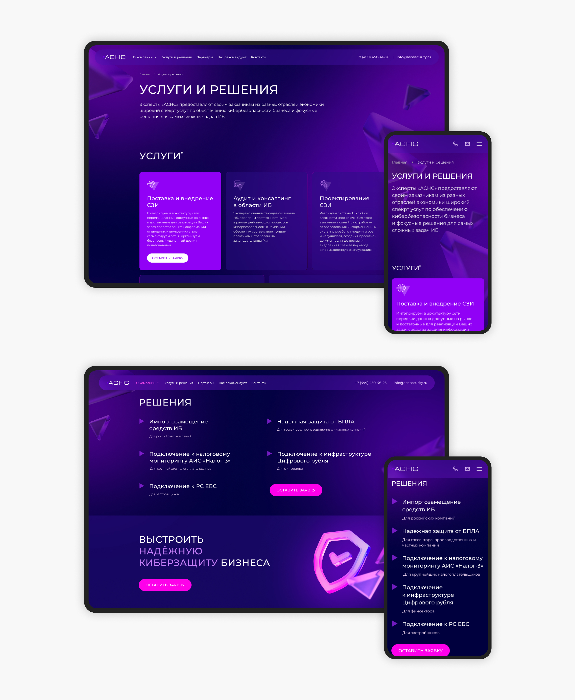
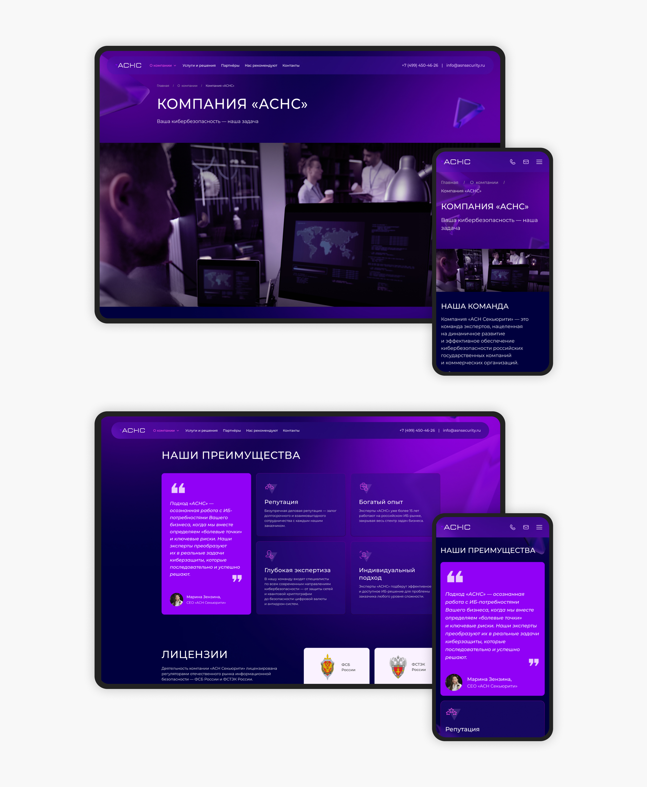

← [Назад к резюме и списку проектов](../README.md)

# ASN Security
**2025**

[asnsecurity.ru](https://asnsecurity.ru/)  
UI/UX, b2b, Web, Cybersecurity

## О проекте

ASN Security — company в сфере информационной безопасности, занимающаяся защитой инфраструктуры, мониторингом угроз и решениями для корпоративной безопасности.

Проект представлял собой разработку корпоративного сайта с нуля. Основная задача заключалась в создании современного и понятного интерфейса, который помогал бы презентовать услуги компании, вызывать доверие у клиентов и структурировать сложную техническую информацию.

**Основные задачи сайта:**
* презентация услуг компании
* описание решений и направлений работы
* публикация информации о технологиях и сервисах
* повышение доверия к бренду
* генерация заявок от потенциальных клиентов.

---

## Что делала

### — UX/UI дизайн

Работа над проектом началась с проектирования структуры сайта и пользовательских сценариев. Необходимо было продумать логику взаимодействия пользователей с контентом и сделать сложную техническую информацию более понятной для восприятия.

При разработке интерфейсов я анализировала сайты компаний из сферы cybersecurity и enterprise-сервисов, чтобы определить удачные UX-решения и способы подачи сложного контента.

Особенность проекта заключалась в том, что аудитория сайта включает как технических специалистов, так и представителей бизнеса. Поэтому интерфейс должен был одновременно выглядеть технологично и оставаться понятным для пользователей без глубокого технического бэкграунда.

Были разработаны:
* структура основных страниц;
* адаптивные версии интерфейсов;
* визуальная концепция проекта;
* система контентных блоков;
* страницы услуг и решений компании.

Визуально было важно уйти от перегруженных «технических» интерфейсов и создать более чистый современный стиль с акцентом на доверие, структуру и читаемость информации.

### — Разработка ui-kit

Для проекта был подготовлен набор компонентов и UI-элементов, который позволил унифицировать интерфейсы и упростить дальнейшую поддержку сайта.

---

## В итоге

Был разработан современный корпоративный сайт, который помогает компании структурированно презентовать свои услуги и решения. Интерфейс понятный, визуально лёгкий и хорошо адаптирован под разные категории пользователей.

---

## Экраны

---
← [Назад к резюме и списку проектов](../README.md)
