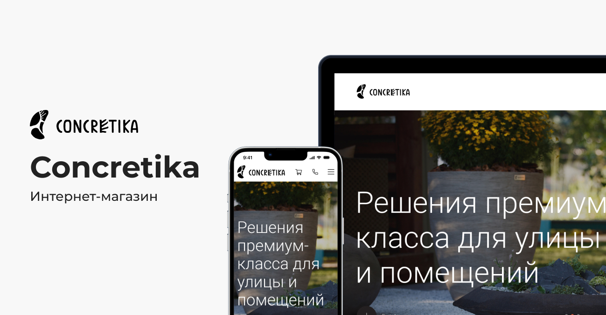
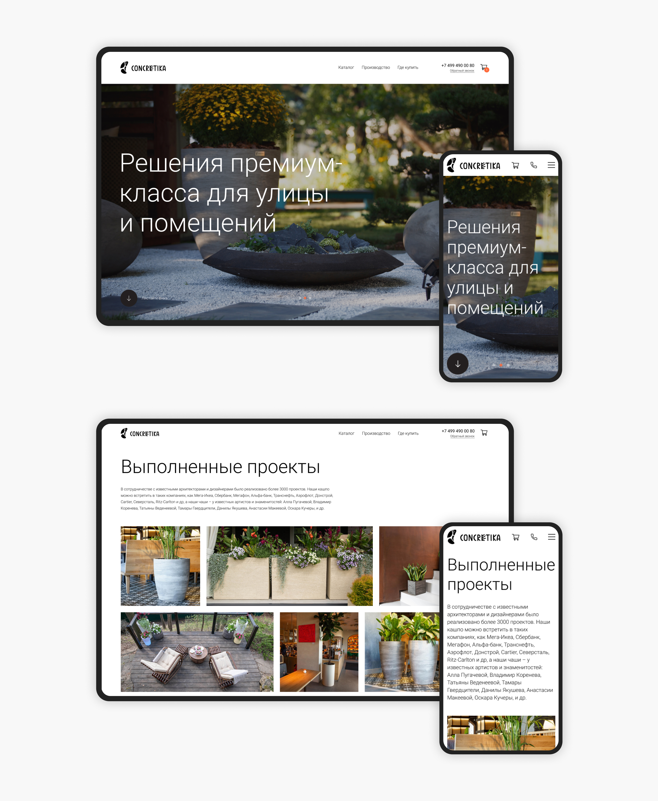
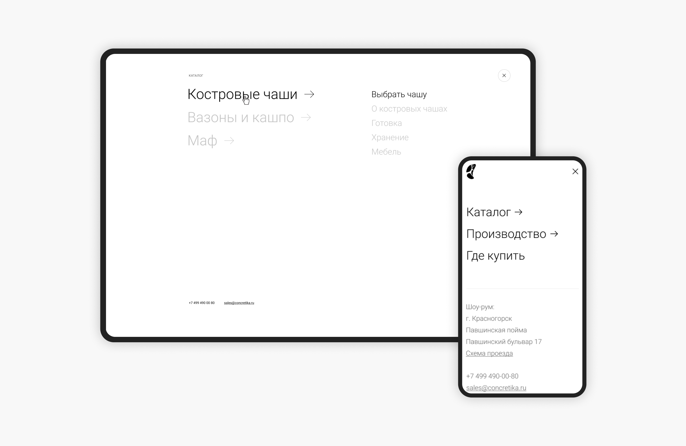
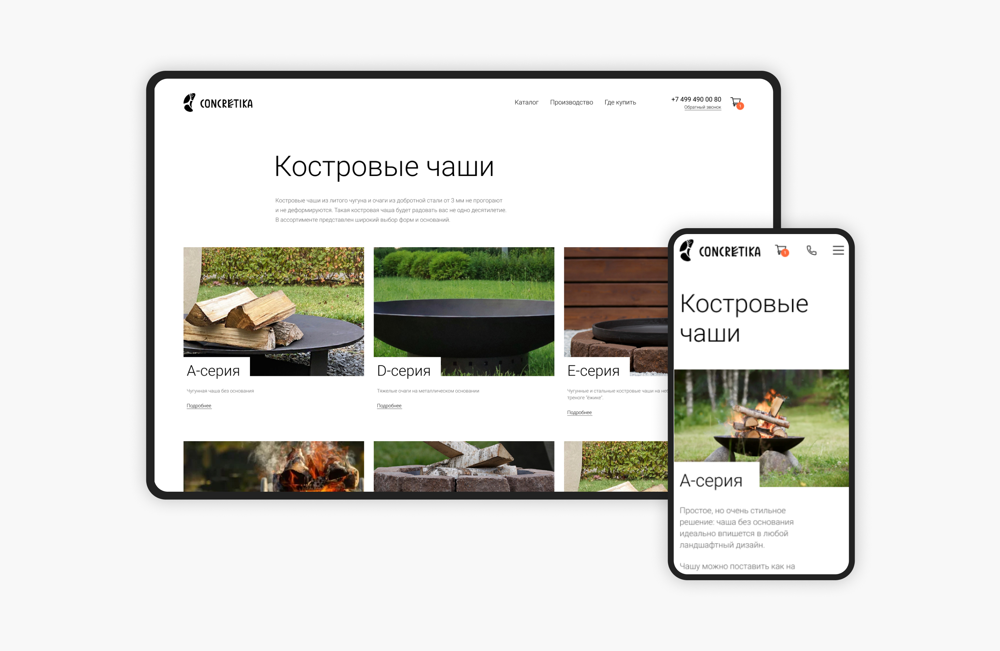
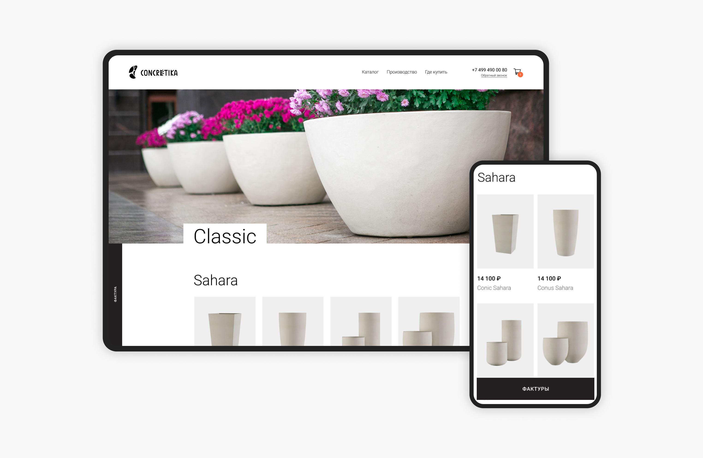
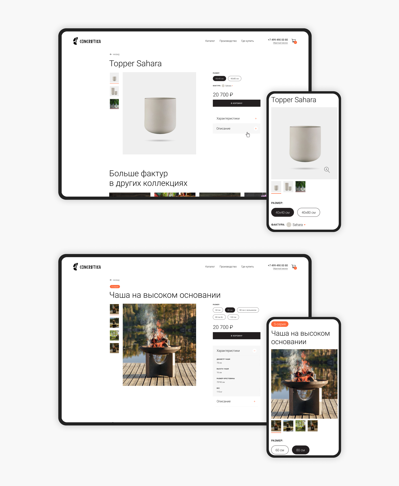
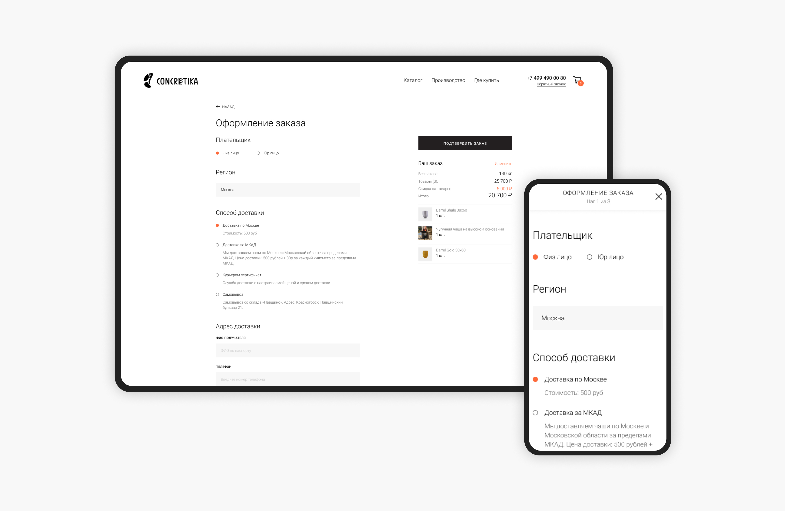
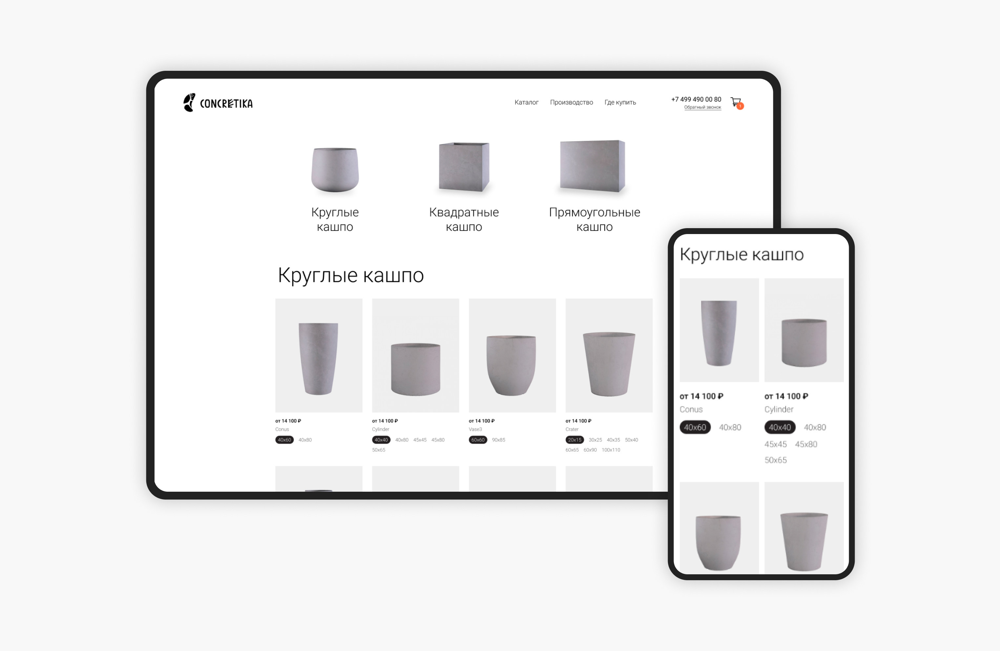
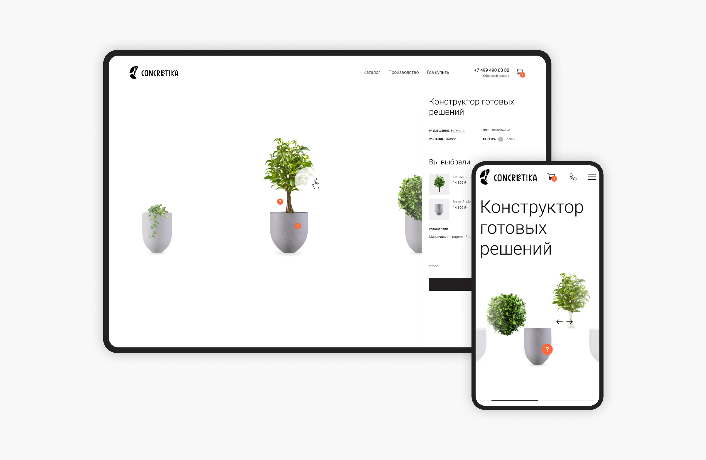

← [Назад к резюме и списку проектов](../README.md)

# Concretika
**2020-2021**

[concretika.ru](https://concretika.ru)  
UI/UX, WEB, e-commerce, Premium Segment

## О проекте
Мастерская «Concretika» производит предметы декора премиум класса: костровые чаши, вазоны и кашпо, а также малые архитектурные формы: скамейки, лавки, террасы, беседки, перголы. 

В начале работы дизайн интернет-магазина не соответствовал премиум сегменту, сайт выглядел просто, а местами и немного мусорно из-за обилия рекламных блоков. Передо мной стояла задача во-первых, сделать редизайн, во-вторых, спроектировать новые страницы сайта.

---

## Что делала

### — Редизайн
У Concretika уже был сайт, но он требовал обновления — дизайн был не актуален, а пользователи часто уходили после просмотра главной страницы, так как не понимали, как посмотреть ассортимент и подобрать костровую чашу или кашпо по своим параметрам. 

Компании нужен был новый эстетичный сайт, который подчеркивал бы премиальный статус бренда, при этом был функциональным и рассказывал обо всех возможностях. 

Особенность продукции заключалась в том, что каждое наименование кашпо представлено в разных размерах и фактурах, а чаши выполнены из разных материалов и могут быть разного размера. Надо было сразу показать эту информацию, чтобы пользователи понимали, что они могут подобрать оптимальный для себя вариант.

Получившийся визуал полностью соответствует образу бренда — стильный, дорогой и современный магазин костровых чаш и кашпо. В дизайне использовала чёрно-белую гамму и крупную, но лёгкую типографику. А рассказ о продукции — важная часть пользовательского опыта, которая не только знакомит покупателей с ассортиментом, но и погружает в атмосферу стиля.

### — Оптимизация существующих функций

#### 1. Главная страница
Разработала блоки, рассказывающие о многообразии форм и фактур, и о проектах, так как важно было подчеркнуть, что мастерская работает не только с физическими лицами, но и крупными компаниями.

#### 2. Навигация
Навигация по каталогу стала двухуровневой, чтобы пользователи сразу видели, что могут подобрать не только, например, костровую чашу, но и аксессуары к ней. При этом навигация очень простая за счёт расставления акцентов.

#### 3. Костровые чаши
Карточки серий в зависимости от материала и основания с крупными привлекательными фотографиями и краткой информацией, чем одна серия отличается от другой.

#### 4. Вазоны и кашпо
Ассортимент кашпо очень велик, в каждой коллекции пользователи могут выбрать не только форму, но и фактуру.

#### 5. Карточка товара
В карточке кашпо сделала акцент на самое важное — размер и фактуру. При этом пользователи в карточке могут выбрать любую фактуру и посмотреть, как будет выглядеть кашпо в этом варианте. Чем лучше покупатель ознакомится с товаром, тем меньше у магазина будет возвратов из-за неправильно подобранной формы или фактуры. Текстовое описание продукции, чтобы не перегружать страницу, убрали в аккордеон. Аналогично сделана карточка костровых чаш, только тут параметр — материал и размер.

#### 6. Корзина и оформление заказа
Ранее для заказа товара покупателю нужно было оставить свои контактные данные, и менеджер магазина связывался с ним для консультации и оформления покупки. Эту возможность оставили, так как некоторые постоянные клиенты предпочитали оформлять заказ именно таким образом, но кроме того разработали полноценную корзину для пользователей, которые хотят самостоятельно выбрать условия получения товара и заполнили данные.

### — Разработка нового функционала

#### 1. Формы и размеры
Чтобы дать покупателям возможность подобрать кашпо не только по коллекции (фактуре), была спроектирована отдельная страница, где можно ознакомиться со всеми возможными формами и размерами кашпо. А чтобы разница была более очевидной, кашпо на этой странице представлены только в нейтральном сером цвете. Но при этом по клику на карточку формы можно перейти на страницу товара и выбрать какую-либо фактуру.

#### 2. Конструктор кашпо
Для удобства пользователей был спроектирован конструктор готовых решений, в котором можно не только выбрать само кашпо в зависимости от фактуры, типа или размещения, но и подобрать подходящее растение. Кроме того из этого раздела можно перейти к оформлению заказа. 

#### 3. О компании
Разработана полноценная страница «О нас», чтобы повысить доверие покупателей. 

#### 4. Видео-рецепты
Чтобы вызвать у покупателей еще больший интерес к костровым чашам была разработана страница с видео-рецептами, где пользователи могут не только посмотреть красочное аппетитное видео с готовкой, но и получить пошаговый текстовый рецепт.

### — Разработка ui-kit
Для упорядочивания используемых проекте элементов и приведения интерфейса к единому стилю был разработан ui-kit. Благодаря этому существенно сократилось время на дизайн и разработку новых блоков сайта.

---

## В итоге
Из невыразительного сайта concretika.ru превратился в стильный, удобный и продающий интернет-магазин, способный приносить прибыль клиенту, а пользователям — дарить эмоции.

---
← [Назад к резюме и списку проектов](../README.md)
