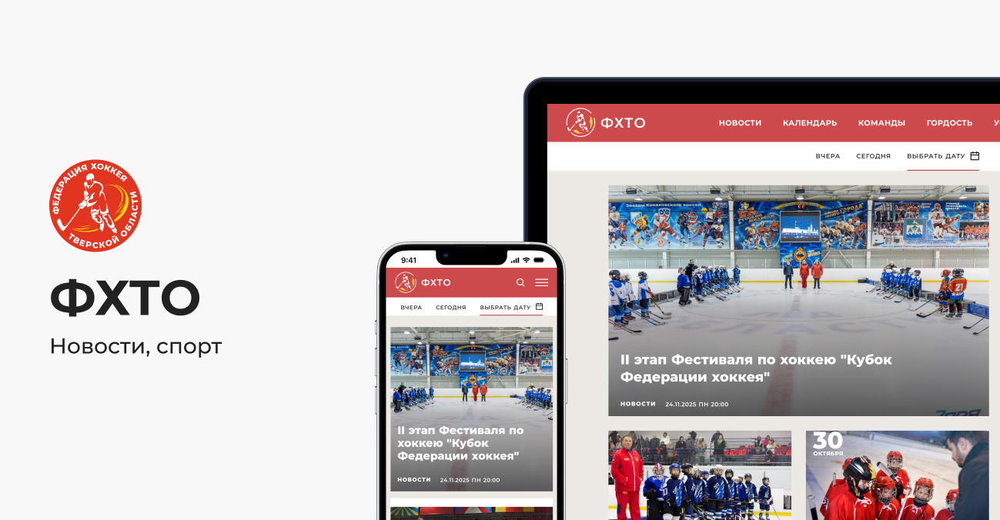
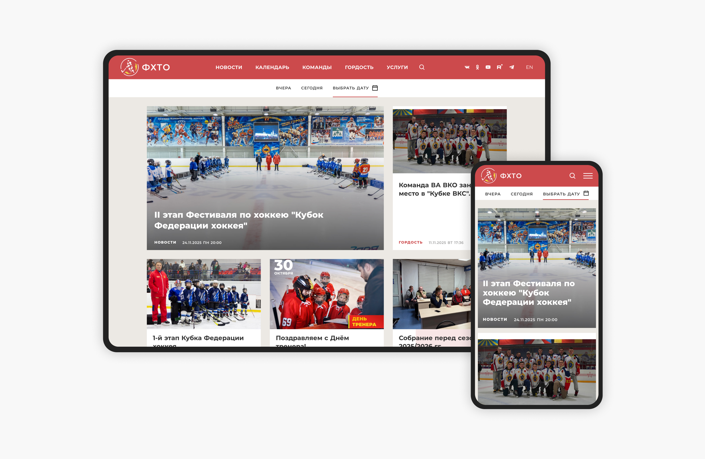
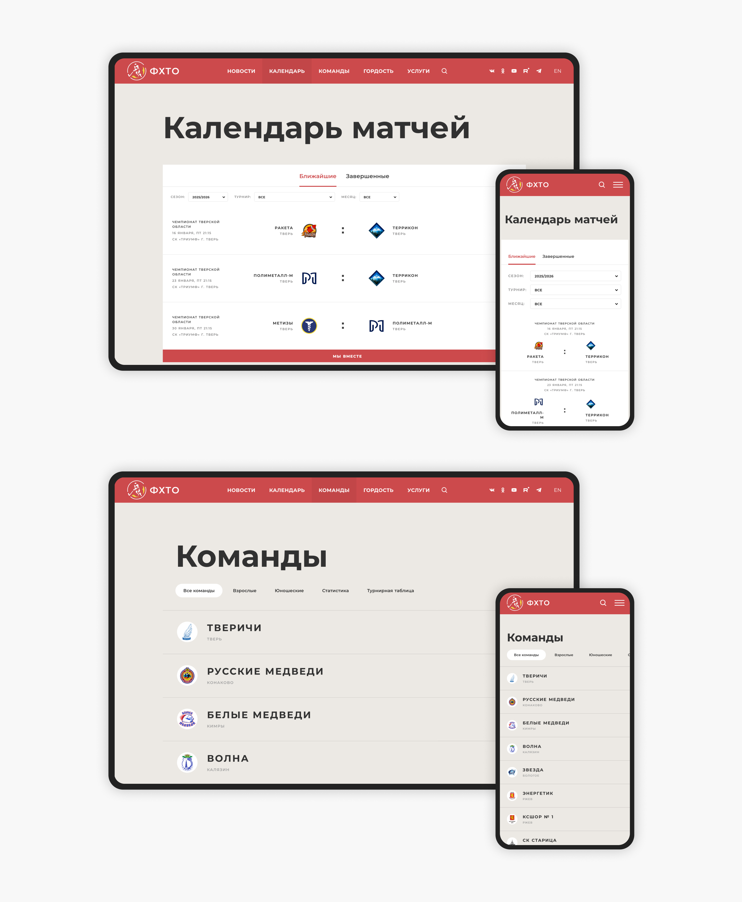
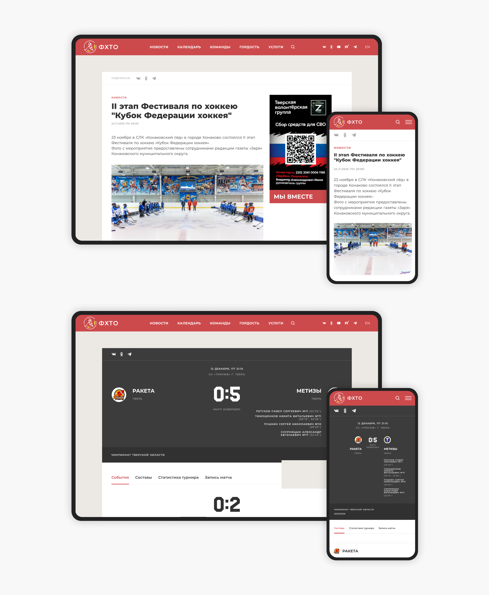

← [Назад к резюме и списку проектов](../README.md)

# Федерация хоккея Тверской области
**2020**

[fhto.ru](https://fhto.ru)  
UI/UX, WEB, media, Sports Management

## О проекте
fhto.ru — официальный сайт Федерации хоккея Тверской области, это информационный и организационный центр для спортсменов, болельщиков и всех, кто интересуется хоккеем.

На сайте можно узнать актуальные новости о событиях в хоккейном сообществе Тверской области, посмотреть расписание предстоящих матчей, турниров и мероприятий, их итоги, а также информацию о хоккейных командах и игроках региона.

---

## Что делала

### — UX/UI дизайн
Сайт разрабатывался с нуля, перед началом работы у ФХТО был только логотип и фирменный цвет.

Я изучила сайты аналогичных региональных федераций хоккея и спортивных организаций, а также новостных порталов, ведь основная задача сайта — рассказывать пользователям о новостях хоккея. Выделила удачные решения: понятная навигация, акцент на новостях и календаре событий, разделы для разных аудиторий (взрослые игроки, родители юных спортсменов, судьи).

Фирменный активный красный цвет сочетала с чётким, читаемым шрифтом, получилось строго, но не скучно: баланс официальности и драйва хоккея.

Особенность проекта в том, что в отличие от клубных сайтов, ориентированных исключительно на своих болельщиков, или новостных порталов, рассчитанных на массовую аудиторию, сайт ФХТО обслуживает сразу несколько целевых групп: хоккеистов разного уровня подготовки, тренеров, судей, родителей юных спортсменов, представителей команд и лиг, а также журналистов и партнёров федерации. Такая многозадачность потребовала особой организации навигации, позволяющей каждому пользователю быстро находить нужную информацию без лишних действий.

А что касается визуала, то вместо перегруженности яркими баннерами и избыточной анимацией здесь выбран путь минимализма с акцентами на функциональности. Чистая сетка вёрстки обеспечивает комфортное чтение контента, а цветовая палитра на основе красного и чёрного выделяет важные элементы, не создавая визуального шума.

### — Разработка ui-kit
Для упорядочивания используемых проекте элементов и приведения интерфейса к единому стилю был разработан ui-kit. Благодаря этому существенно сократилось время на дизайн и разработку новых блоков сайта.

---

## В итоге
Разработан сайт, который находит баланс между официальной тональностью, необходимой для представительства региональной федерации, и человеческой интонацией, которая вовлекает аудиторию.

---

## Экраны

---
← [Назад к резюме и списку проектов](../README.md)
