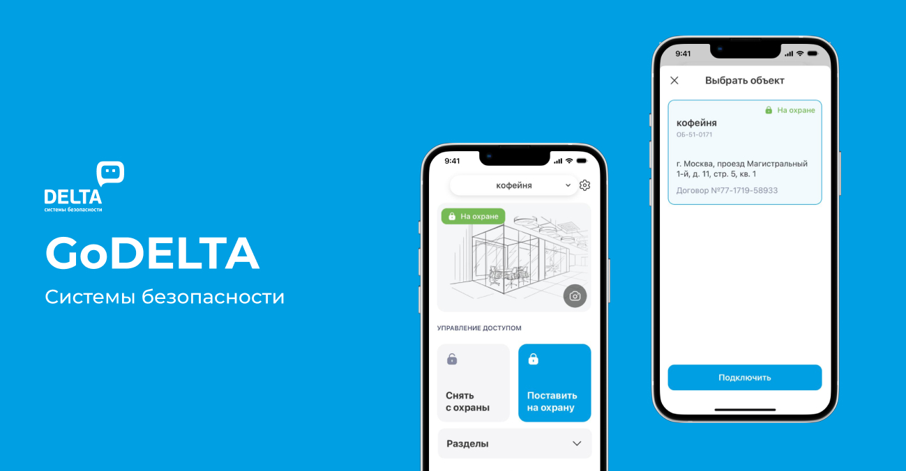
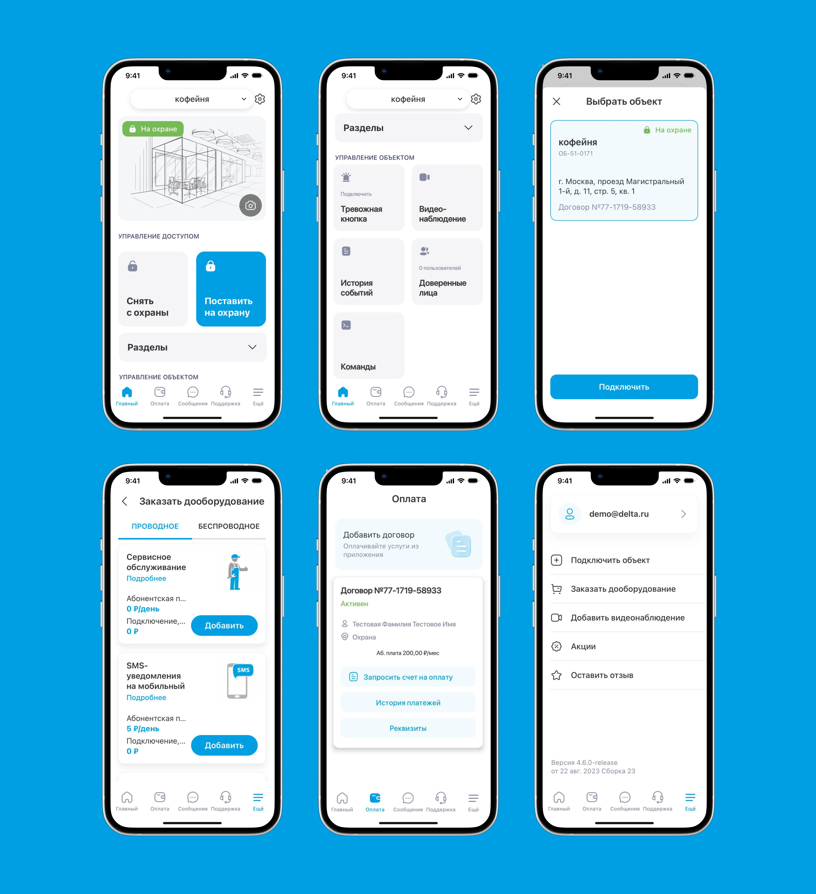

← [Назад к резюме и списку проектов](../README.md)

# GoDELTA
**2022-2024**

[App Store](https://apps.apple.com/ru/app/godelta/id708986747)  
UI/UX, iOS, Android, e-commerce, IoT, Security

## О проекте
Компания DELTA — федеральный провайдер услуг безопасности, создавший полноценную экосистему решений для защиты объектов бизнеса, частной недвижимости и транспортных средств.

Мобильное приложение позволяет пользователям управлять безопасностью объектов, ставить на охрану, снимать с охраны, включать тревожную кнопку и просматривать журнал тревог.

Я подключилась к работе над уже готовым продуктом и моей задачей была разработка экранов с новыми функциями и внесение небольших изменений в текущий дизайн. Кроме того, учитывая сферу продукта, приходилось постоянно консультироваться с разработчиками о возможности внедрения той или иной функции.

---

## Что делала

### — Дизайн-поддержка проекта
В Личный кабинет был добавлен раздел с документами, где пользователи могут посмотреть документы по каждому подключённому объекту и скачивать их.

А если раньше счёт на оплату можно было скачать только за текущий месяц, то теперь пользователи могут выбрать нужный период и оплатить счёт на несколько месяцев вперёд.

Также в дополнение к существующей оплате банковской картой или СБП была добавлена оплата через Sber Pay.

### — Разработка нового функционала
В Личном кабинете появился целый раздел, где пользователи могут выбрать и приобрести дополнительное оборудование: камеры, датчики, тревожные кнопки и т.п. Раньше такая возможность была только в веб-версии сервиса.

В функционал видеонаблюдения были добавлены расширенные настройки камеры: детектор движения, настройки чувствительности. Кроме того, у пользователей появилась возможность скачать нужный фрагмент видеозаписи.

### — Поддержка ui-kit

---

## В итоге
Мобильное приложение DELTA постоянно развивается, в нём появляются новые функции для пользователей. Это существенно упрощает жизнь клиентам, которые не всегда имеют возможность воспользоваться десктопной версией личного кабинета.

---

## Экраны

---
← [Назад к резюме и списку проектов](../README.md)
