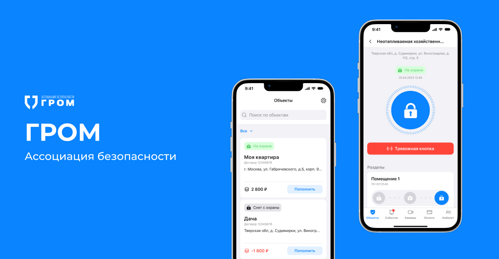
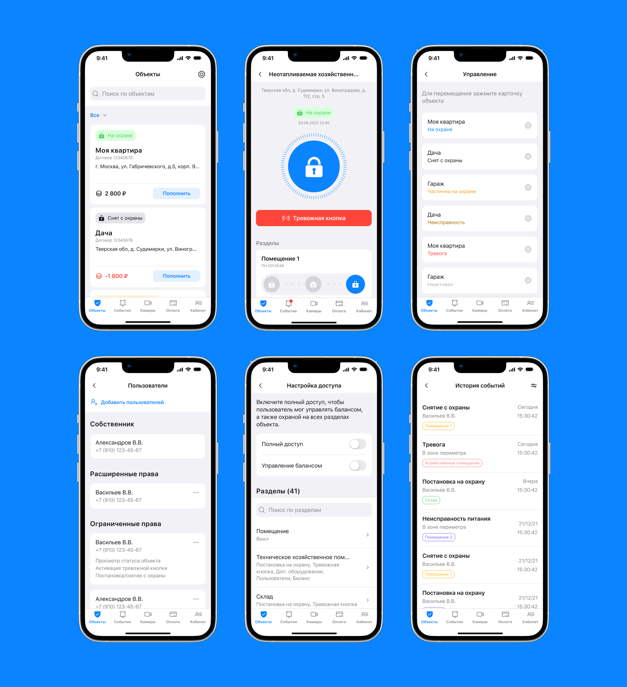
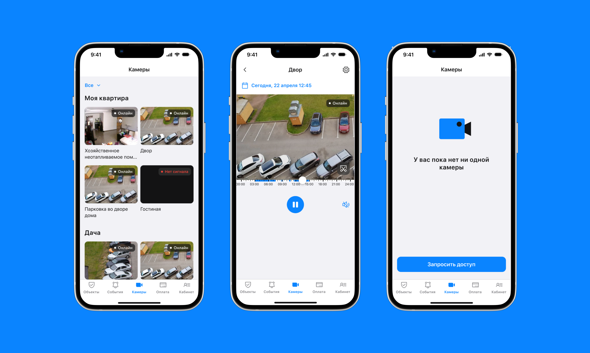
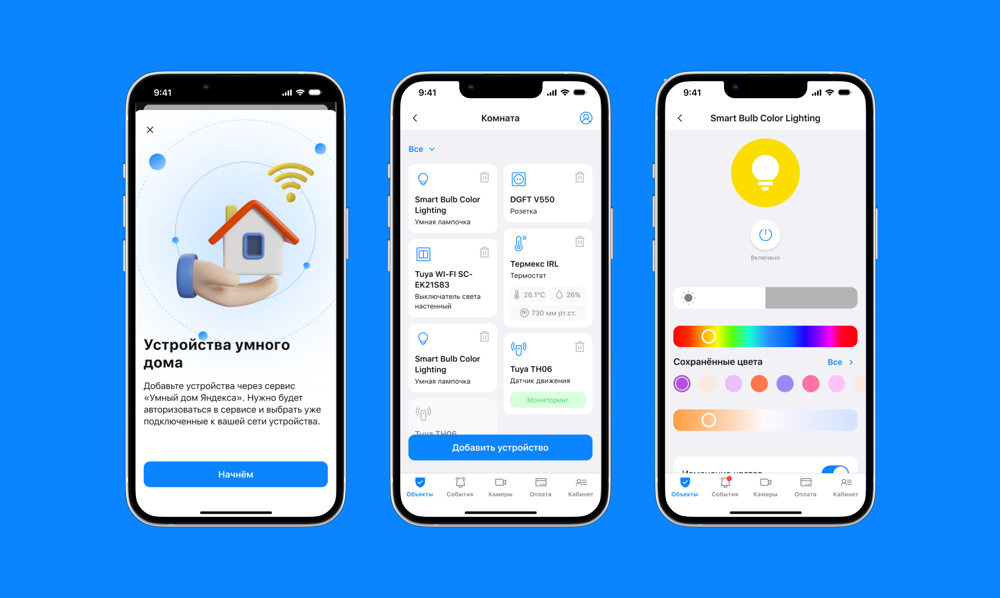

← [Назад к резюме и списку проектов](../README.md)

# Гром
**2023**

[Google Play](https://play.google.com/store/apps/details?id=ru.grom.android)  
UI/UX, iOS, Android, e-commerce, IoT, Security

## О проекте
Ассоциация безопасности «ГРОМ» объединяет различные охранные предприятия.

У мобильного приложения много функций: в нём можно управлять безопасностью объектов (постановка на охрану, снятие с охраны, активация тревожной кнопки), просматривать журнал тревог, управлять устройствами умного дома и личным кабинетом.

Приложение было создано с нуля для платформ iOS и Android. Дизайн разрабатывался на основе существующих бизнес-процессов клиента с учётом большого количества охраняемых объектов и особенностей работы с ними.

---

## Что делала

### — UX/UI дизайн
Главный экран приложения — список объектов, безопасностью которых управляет пользователь. Объектов может быть много, поэтому предусмотрен поиск и фильтрация. У каждого объекта виден его статус, адрес и баланс счёта. Список статусов тоже большой, поэтому было сделано цветовое кодирование, чтобы пользователи могли быстро понять, что происходит на объекте.

Непосредственно на экране объекта пользователь может активировать тревожную кнопку, снять объект с охраны, поставить на охрану, управлять помещениями, которые находятся внутри объекта, подключать оборудование и т.д.

Особенность продукта заключается в том, что к каждому объекту доступ могут иметь несколько человек, но с разными правами. Поэтому возможность добавления новых пользователей, настройка прав была вынесена именно в карточку объекта. А видеонаблюдение реализовано на отдельном экране с фильтрацией по объектам, поскольку эта функция нужна лишь некоторым сотрудникам.

Функциональность приложения не ограничивается только управлением безопасностью, есть и опция подключения устройств умного дома. Для них был разработан целый раздел с возможностью подключения, удаления, настройки и управления правами других пользователей.

Что касается визуала, фирменный стиль клиента (сайт, соцсети) выглядел несколько устаревшим, поэтому было решено взять только фирменный цвет и создать минималистичный лёгкий дизайн, чтобы ничто не отвлекало пользователей от работы в приложении.

### — Разработка ui-kit

### — Подготовка к публикации в сторах

---

## В итоге
Для клиентов охранных предприятий был разработан удобный и логичный инструмент управления и настройки безопасности на объектах.

---

## Экраны

---
← [Назад к резюме и списку проектов](../README.md)
