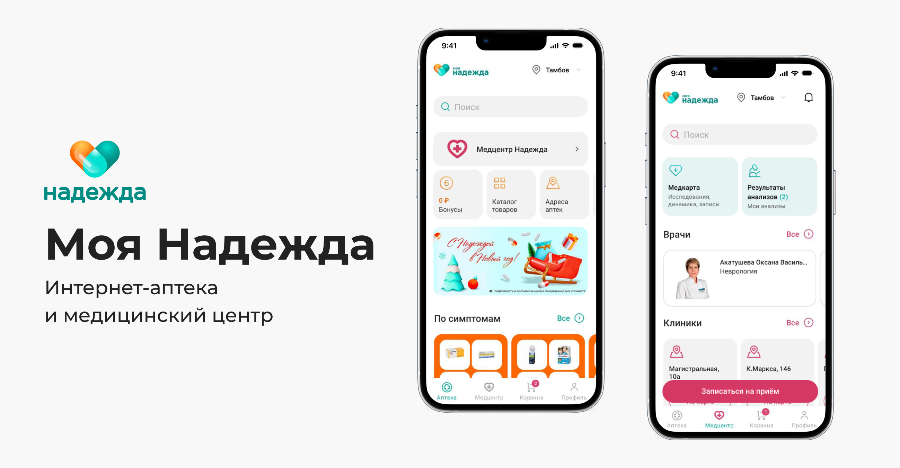
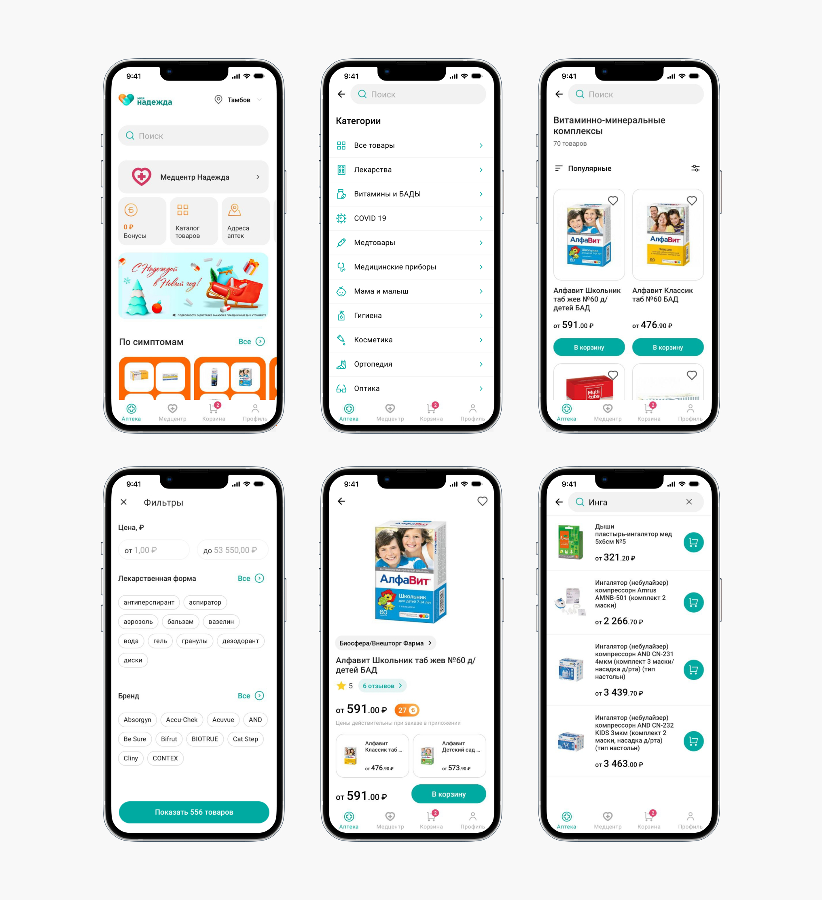
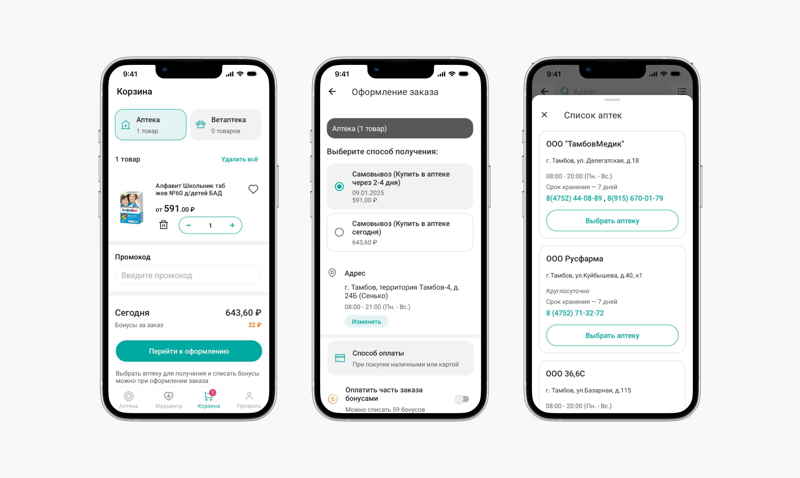
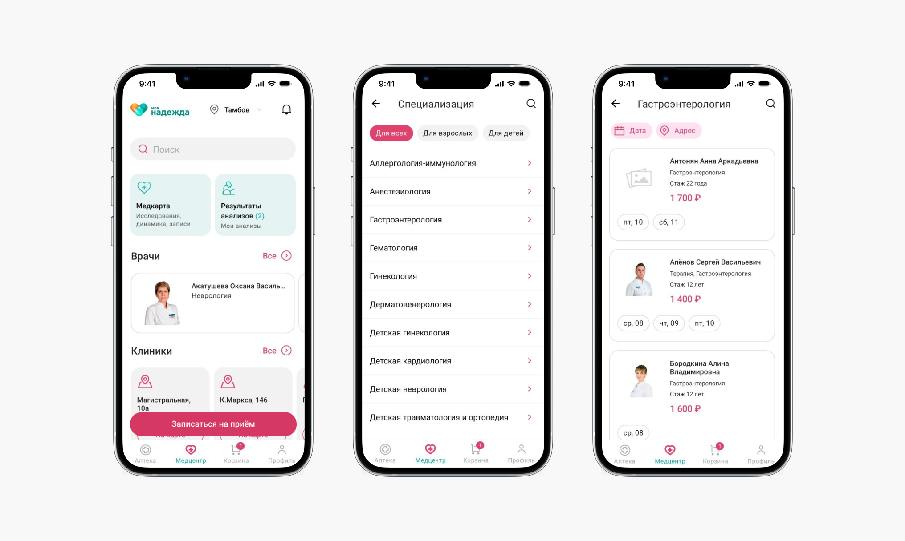

← [Назад к резюме и списку проектов](../README.md)

# Аптека и медицинский центр Моя надежда
**2024**

[Google Play](https://play.google.com/store/apps/details?id=ru.nfapteka.android), [RuStore](https://www.rustore.ru/catalog/app/ru.nfapteka.android)  
UI/UX, iOS, Android, e-commerce, Medical, MedTech

## О проекте
«Моя Надежда» (ранее «Надежда Фарм») — это федеральная аптечная сеть, насчитывающая более 500 аптек в 25 субъектах РФ.

**Основные функции мобильного приложения:**
* покупка лекарств
* поиск и подбор лекарств
* возможность найти ближайшую аптеку с нужными лекарствами
* бонусная программа
* запись в медицинский центр.

Дизайн приложения разрабатывался с нуля для платформы Android на основе существующих бизнес-процессов клиента.

---

## Что делала

### — UX/UI дизайн
В начале работы у сети «Моя Надежда» уже имелся веб-сайт, где пользователи также могли заказывать и бронировать товары. Задача заключалась в том, чтобы для мобильного приложения разработать экраны и настроить методы взаимодействия с сервером через API. Однако необходимо было учитывать, что важным аспектом является разработка архитектуры и логики, поскольку механика в мобильных приложениях отличается от веба.

При разработке дизайна мобильного приложения целью было сделать его максимально удобным и простым для всех пользователей, даже для людей, не имеющих опыта работы с мобильными приложениями.

Кроме того, в приложение необходимо было интегрировать еще и функциональность записи в собственный медицинский центр компании.

В начале работы я собрала анализ конкурентов, где выделила их слабые и сильные стороны, и ключевые ориентиры при проектировании приложения:
* функциональность, привычная пользователям данного сегмента
* удобство и безопасность авторизации
* быстрота поиска товаров и оформления заказа
* сильный визуал для создания целостного и запоминающегося образа продукта
* для медицинского центра: простой и понятный поиск врача и запись на приём

Перед проектированием экранов для заказчика было разработано несколько вариантов концепта приложения. Важно было, чтобы визуал опирался на фирменный стиль клиента, но при этом был достаточно современным.

Я разработала экраны для следующих функций:

#### 1. Главный экран и программа лояльности
На главном экране есть кнопка поиска, чтобы пользователи при необходимости могли быстро найти нужный товар, виджеты с часто используемыми функциями (каталог, поиск аптек, бонусная программа, избранные товары, мои заказы, запись в медцентр). Также здесь показаны персональные предложения и акции, подборки товаров.

#### 2. Каталог и карточки товаров
Пользователям важно иметь возможность удобного подбора нужного лекарства или его аналогов. Поэтому в приложении есть простая и понятная навигации по каталогу, фильтрация и сортировка. Каталог имеет чёткую структуру по категориям — а это серьезное преимущество мобильной аптеки перед аптекой физической. Каждая категория подкреплена интуитивно понятной иконкой и перенаправляет пользователя на соответствующий список товаров.

В карточке товара представлена самая подробная информация о продукции (описание, бонусы, формы и аналоги, цены, способы получения, наличие в аптеках, отзывы). Есть возможность быстрого заказа без оформления через корзину: достаточно ввести номер телефона и подтвердить покупку по звонку или смс.

#### 3. Поиск
Разработан поиск по каталогу товаров с возможностью выбора категории. Поиск сохраняет историю запросов, дает подсказки и выдает запросы в алфавитном порядке.

#### 4. Корзина и оформление заказа
Особое внимание я уделила дизайну корзины и оформлению заказа. Например, в корзине, кроме списка товаров, выделен отдельный список для лекарств, которых сейчас нет в наличии. Так пользователи не потеряют товары, которые добавили ранее в корзину, и смогут подобрать аналоги. Саммари по корзине представляет собой отдельный блок, где можно увидеть не только сумму заказа, но и скидку, количество начисляемых бонусов, скидку по промокоду.

Само оформление заказа должно быть максимально простым и понятным для всех пользователей. Поэтому этот процесс визуально разбит на шаги, тут присутствуют инструкции и подсказки. Пользователь может выбрать способ получения, способ оплаты, списать бонусные баллы, ввести промокод.

#### 5. Авторизация и управление личным кабинетом
В приложении простая и безопасная авторизация по номеру телефона, а также есть возможность управления личным кабинетом и данными профиля, просмотра истории заказов.

#### 6. Медицинский центр
Отдельный большой раздел приложения — это медицинский центр. Тут пользователи могут записаться на приём в клинику «Надежда», предварительно выбрав врача или услугу, посмотреть результаты анализов и исследований, динамику показателей. При разработке этого раздела были заложены интуитивно понятные переходы и функции, при использовании которых, пользователи могут не только быстро выбрать удобное время посещения врача, но и получить доступ к своей электронной медицинской карте.

### — Разработка ui-kit

---

## В итоге
Для клиентов аптеки было разработано удобное и логичное приложение для подбора товаров, оформления заказов и записи в медицинский центр. А для самого заказчика наличие мобильного приложения показывает стремление к инновациям и удовлетворению потребностей пользователей.

---

## Экраны

---
← [Назад к резюме и списку проектов](../README.md)
