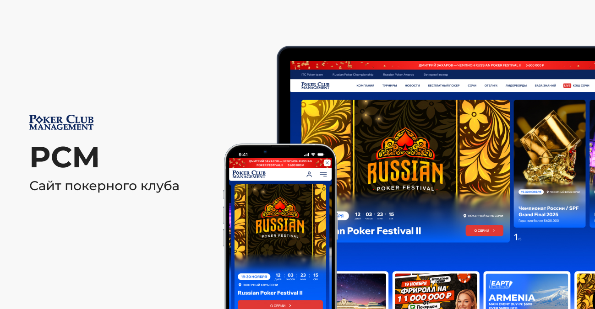
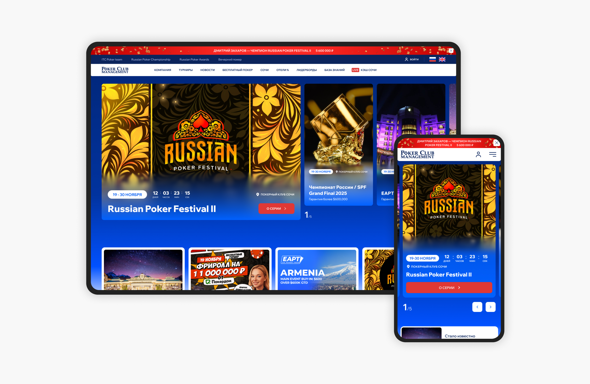
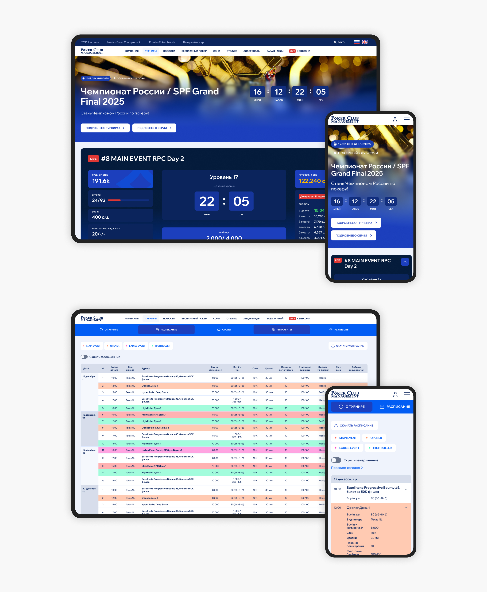
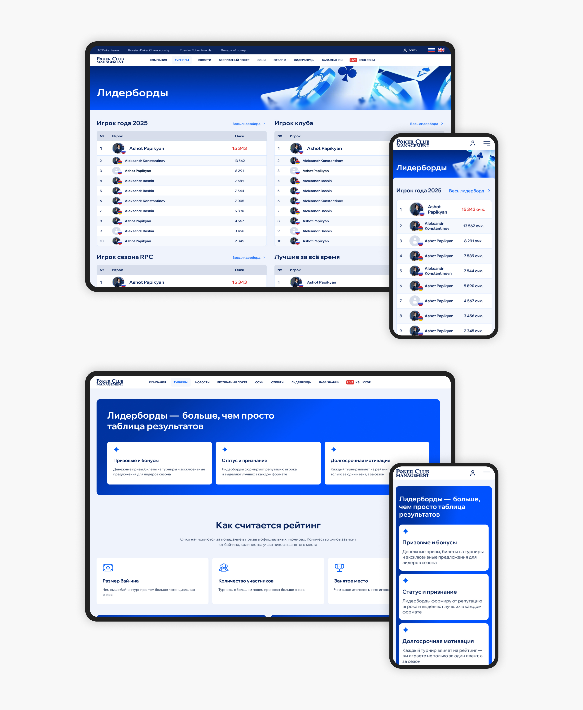

← [Назад к резюме и списку проектов](../README.md)

# Poker Club Management
**2026**

**Теги:** UI/UX, entertainment, Web

## О проекте
Poker Club Management — платформа для игроков покерного клуба и сообщества. Пользователи могут смотреть расписание турниров, статистику и результаты игр, рейтинги игроков, новости клуба и информацию о предстоящих событиях.

На момент начала работы у проекта уже был обновлён фирменный стиль, однако сам сайт визуально и структурно ему не соответствовал. Многие разделы представляли собой длинные текстовые страницы без чёткой иерархии, из-за чего пользователям было сложно быстро находить нужную информацию.

**Основные функции сервиса:**
* расписание турниров и событий
* рейтинги игроков
* просмотр результатов игр
* новости и анонсы клуба
* страницы турниров и мероприятий

Дизайн приложений и сайтов разрабатывался с нуля на основе анализа конкурентов, потребностей пользователей и запросов клиента.

---

## Что делала

### — UX/UI redesign и переработка информационной архитектуры
На момент старта проекта у клуба уже был обновлён фирменный стиль, однако сам сайт оставался перегруженным и плохо масштабировался под большое количество контента. Основной проблемой была не визуальная часть, а структура: пользователям было сложно быстро находить расписание турниров, рейтинги и информацию о событиях клуба.

Моей задачей было не просто обновить интерфейс под новый брендинг, а полностью пересобрать пользовательский опыт платформы: определить приоритеты контента, упростить навигацию и сделать сайт удобным для регулярного использования.

Перед проектированием я проанализировала текущие пользовательские сценарии и выделила несколько ключевых проблем:
* длинные текстовые страницы без визуальной иерархии;
* слабая навигация между разделами;
* перегруженные страницы турниров;
* сложность восприятия рейтингов и результатов;
* неудобное использование сайта с мобильных устройств.

После анализа была полностью переработана информационная архитектура платформы. Я пересобрала структуру страниц, выделила ключевые пользовательские сценарии и перераспределила акценты таким образом, чтобы пользователи могли быстрее ориентироваться в расписании, рейтингах и событиях клуба.

В рамках проекта были:
* переработаны страницы турниров и рейтингов;
* спроектированы новые контентные блоки;
* внедрена единая система визуальных акцентов;
* упрощена навигация между разделами;
* переработана мобильная версия сайта;
* стандартизированы карточки событий и турниров.

Одной из ключевых задач было сохранить эмоциональную атмосферу покерного сообщества, не жертвуя usability. Интерфейс должен был одновременно работать как информационный сервис, вовлекающая community-платформа и часть имиджа бренда.

### — Разработка UI-kit
Для проекта был собран UI-kit и система компонентов, которые позволили унифицировать интерфейсы и упростить дальнейшее развитие продукта. Это помогло сократить количество визуальных расхождений между разделами и ускорить работу над новыми страницами.

---

## В итоге
В результате редизайна сайт стал значительно понятнее с точки зрения навигации и восприятия информации. Пользователи получили более быстрый доступ к ключевым сценариям: просмотру турниров, рейтингов и событий клуба.

Кроме визуального обновления удалось выстроить более масштабируемую структуру платформы, которая упростила дальнейшее развитие продукта и поддержку новых разделов.

---

## Экраны

---
← [Назад к резюме и списку проектов](../README.md)
