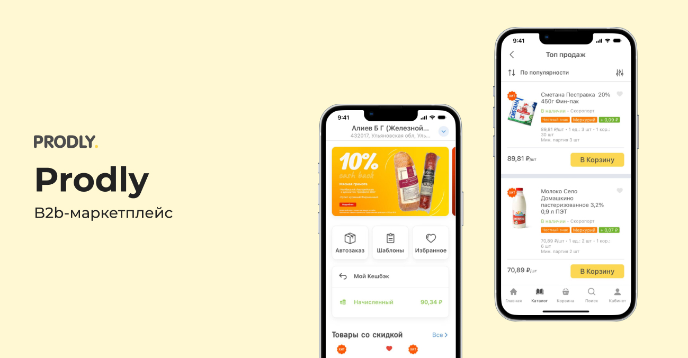
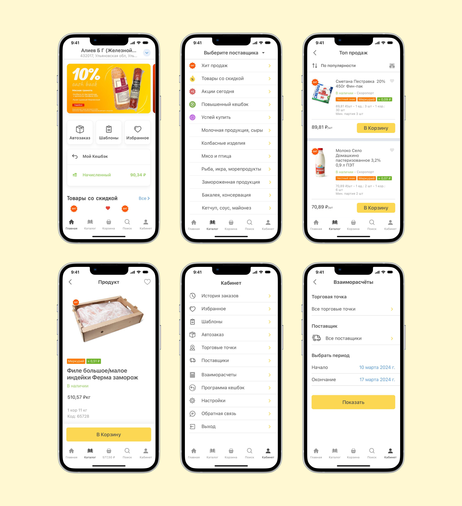

← [Назад к резюме и списку проектов](../README.md)

# Prodly
**2022-2024**

[App Store](https://apps.apple.com/ru/app/prodly-%D0%BC%D0%B0%D1%80%D0%BA%D0%B5%D1%82%D0%BF%D0%BB%D0%B5%D0%B9%D1%81/id1585773676)  
UI/UX, iOS, Android, B2B, e-commerce

## О проекте
Prodly — B2B-маркетплейс для бизнеса. В мобильном приложении сотрудники компаний могут заказывать продукты и хозтовары на адреса своих торговых точек.

У сервиса есть веб-сайт, где клиенты оформляют заказы и следят за документооборотом, поэтому основная функция мобильного приложения — расширить доступность сервиса для текущих и будущих пользователей за счет появления дополнительного канала продаж.

На этом проекте я занималась доработкой существующих экранов и проектированием нового функционала.

---

## Что делала

### — Дизайн-поддержка проекта
Были расширены существующие функции для пользователей. Например, при регистрации в сервисе пользователи теперь могут самостоятельно добавлять и настраивать торговые точки, заполнив их название, адрес, вид деятельности.

В каталог товаров были добавлены новые категории, а в карточки продукции разнообразные лейблы, которые помогают понять, что товар участвует в той или иной маркетинговой акции или что товар имеет какой-либо уникальный признак. Например, был разработан дизайн для группы товаров с ограничением просмотра (18+).

Был оптимизирован фильтр по поставщикам и поиск товара. Теперь пользователи сразу понимают, видят ли они глобальный каталог или товары, имеющиеся у определённого поставщика.

### — Разработка нового функционала
В дополнение к существующей программе лояльности, где пользователи получали кешбэк за совершённые заказы, появился функционал фотоотчётов. Теперь пользователям доступны задания, где надо сфотографировать и отправить выкладку товаров. За выполненные задания пользователи получают баллы, которые можно тратить на покупку сертификатов.

В каталог товаров был добавлен поиск по штрих-коду, что упростило процесс заказа для пользователей. Если раньше им приходилось искать товар в каталоге или в истории заказов, то сейчас достаточно сфотографировать штрих-код товара, который надо заказать повторно.

### — Оптимизация макетов и ui-kit
В макетах, с которыми я начинала работать, не было полноценного ui-kit. Я собрала используемые компоненты в ui-kit, максимально автоматизировала процесс дизайна.

---

## В итоге
В мобильном приложении появилось много функций, которые раньше были доступны только на сайте, выросло количество пользователей, которые совершают заказы в приложении.

---

## Экраны

---
← [Назад к резюме и списку проектов](../README.md)
