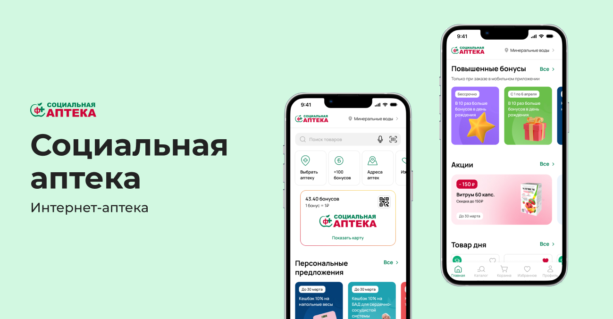
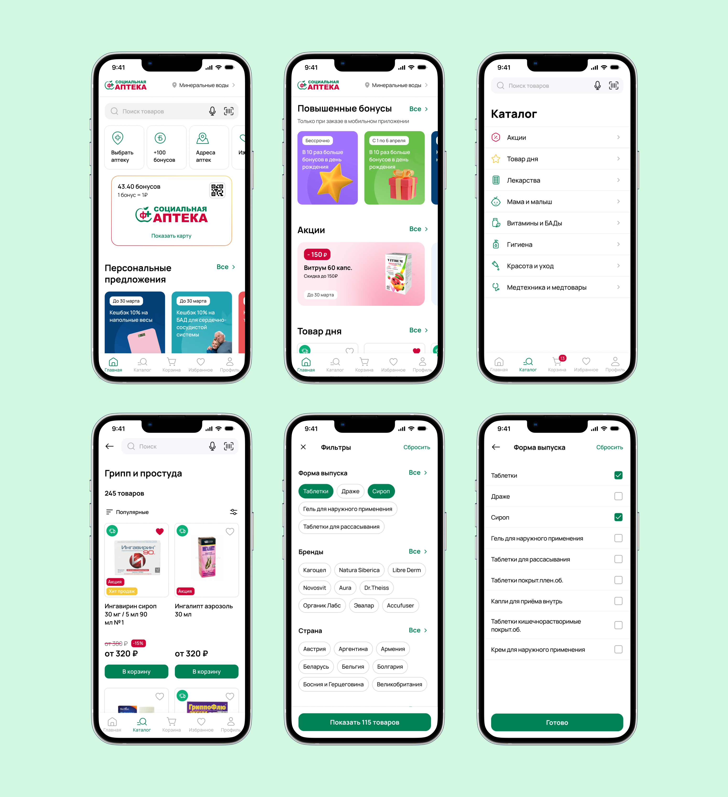
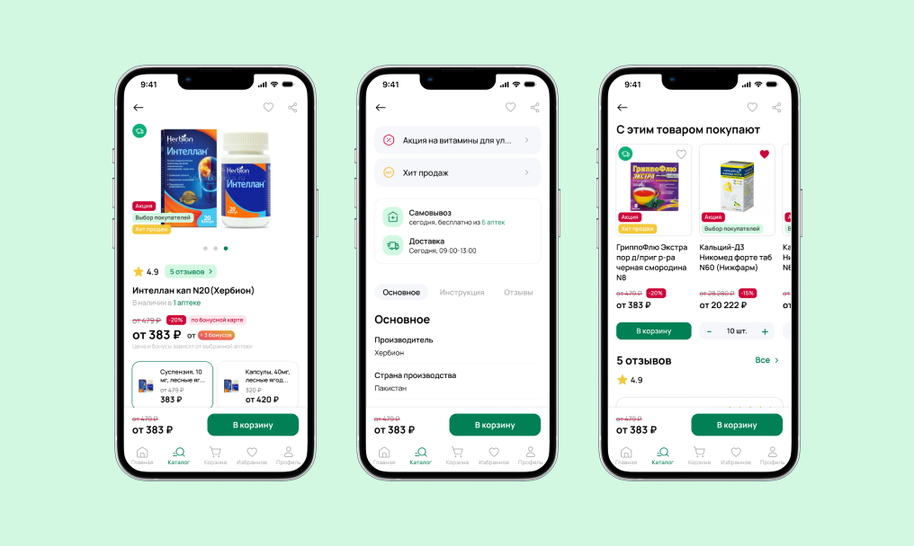
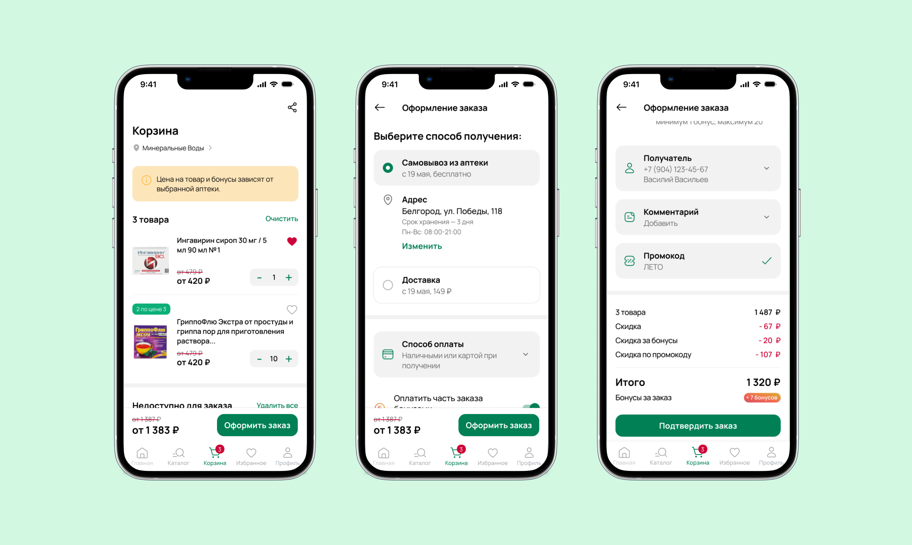

← [Назад к резюме и списку проектов](../README.md)

# Социальная аптека
**2022-2023**

UI/UX, iOS, Android, e-commerce, Medical

## О проекте
«Социальная аптека» — это аптечная сеть, которая насчитывает более 620 аптек по всей России.

**Основные функции мобильного приложения:**
* покупка лекарств
* поиск лекарств с помощью сканирования штрих-кода
* возможность найти ближайшую аптеку с нужными лекарствами
* карта лояльности, которую можно показывать в аптеке при покупке оффлайн.

Дизайн приложения разрабатывался с нуля для платформы Android на основе существующих бизнес-процессов клиента.

---

## Что делала

### — UX/UI дизайн
В начале работы у «Социальной аптеки» уже имелся веб-сайт, где пользователи также могли заказывать и бронировать товары. Задача заключалась в том, чтобы для мобильного приложения разработать экраны и настроить методы взаимодействия с сервером через API. Однако необходимо было учитывать, что важным аспектом является разработка архитектуры и логики, поскольку механика в мобильных приложениях отличается от веба.

При разработке дизайна мобильного приложения целью было сделать его максимально удобным и простым для всех пользователей, даже для людей, не имеющих опыта работы с мобильными приложениями.

В начале работы у меня были данные, предоставленные заказчиком (целевая аудитория сервиса, интервью с респондентами), CJM и карта пользовательских историй. Потом я собрала анализ конкурентов, где выделила их слабые и сильные стороны, и ключевые ориентиры при проектировании приложения:
* функциональность, привычная пользователям данного сегмента
* удобство и безопасность авторизации
* быстрота поиска товаров и оформления заказа
* сильный визуал для создания целостного и запоминающегося образа продукта
* добавление полезных функций, например, «любимой аптеки», чата с фармацевтом, подборки аптечек и т.п.

Перед проектированием экранов для заказчика был разработан мудборд и несколько вариантов концепта приложения. Важно было, чтобы визуал опирался на фирменный стиль клиента, но при этом был достаточно современным.

Я разработала экраны для следующих функций:

#### 1. Главный экран и программа лояльности
На главном экране есть кнопка поиска, чтобы пользователи при необходимости могли быстро найти нужный товар, виджеты с часто используемыми функциями (поиск аптек, бонусная программа, избранные товары, мои заказы). Также здесь показаны персональные предложения и акции, подборки товаров. Отдельно стоит выделить карту лояльности. Для многих пользователей это важная функциональность, так они могут быстро показать карту при покупке в аптеке и сразу увидеть количество накопленных бонусов.

#### 2. Каталог и карточки товаров
Пользователям важно иметь возможность удобного подбора нужного лекарства или его аналогов. Поэтому в приложении есть простая и понятная навигации по каталогу, фильтрация и сортировка. А в карточке товара представлена самая подробная информация (описание, бонусы, формы и аналоги, цены, способы получения, наличие в аптеках, отзывы).

#### 3. Поиск
Разработан поиск по каталогу товаров с возможностью фильтрации и сортировки результатов, поиск по штрих-коду, поиск товара в выбранной аптеке.

#### 4. Корзина и оформление заказа
Особое внимание я уделила дизайну корзины и оформлению заказа. Например, в корзине, кроме списка товаров, выделен отдельный список для лекарств, которых сейчас нет в наличии. Так пользователи не потеряют товары, которые добавили ранее в корзину, и смогут подобрать аналоги. Саммари по корзине представляет собой отдельный блок, где можно увидеть не только сумму заказа, но и скидку, количество начисляемых бонусов, скидку по промокоду.

Само оформление заказа должно быть максимально простым и понятным для всех пользователей. Поэтому этот процесс визуально разбит на шаги, тут присутствуют инструкции и подсказки. Пользователь может выбрать способ получения, способ оплаты, списать бонусные баллы, ввести промокод, добавить или выбрать получателя, написать комментарий к заказу.

#### 5. Авторизация и управление личным кабинетом
В приложении простая и безопасная авторизация по номеру телефона, а также есть возможность управления личным кабинетом и данными профиля, просмотра истории заказов, настройки уведомлений.

### — Разработка ui-kit

---

## В итоге
Для клиентов аптеки было разработано удобное и логичное приложение для подбора товаров, оформления заказов и участия в программе лояльности. А для самого заказчика наличие мобильного приложения показывает стремление к инновациям и удовлетворению потребностей пользователей.

---

## Экраны

---
← [Назад к резюме и списку проектов](../README.md)
