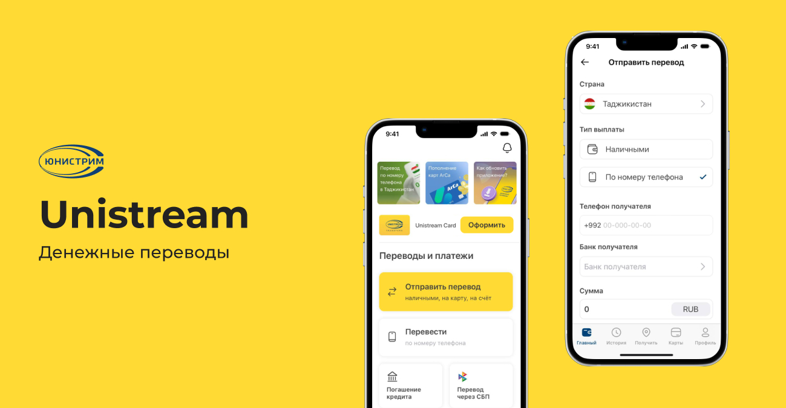
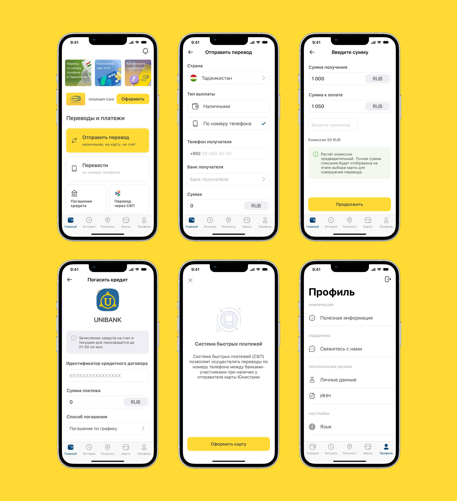

← [Назад к резюме и списку проектов](../README.md)

# Unistream
**2022-2024**

[RuStore](https://apps.rustore.ru/app/com.ltech.unistream)  
UI/UX, Banking&finance, iOS, Android, PWA

## О проекте
Unistream — международный сервис денежных переводов и оплаты услуг. Пользователи приложения могут отправлять переводы по всему миру, оплачивать сервисы, управлять своими операциями и взаимодействовать с финансовыми продуктами компании.

На момент начала работы продукт уже имел большую аудиторию и развитую функциональность, однако интерфейсы постепенно усложнялись, а UX отдельных сценариев переставал соответствовать ожиданиям пользователей. Кроме того, продукт активно развивался: появлялись новые сервисы, внутренние инструменты и web-направления.

Моя задача заключалась не только в поддержке существующего приложения, но и в системном развитии продукта: улучшении пользовательских сценариев, проектировании нового функционала, оптимизации дизайн-системы и адаптации сервиса под новые бизнес-условия.

**Основные функции приложения:**
* международные денежные переводы
* оплата услуг
* история операций
* управление шаблонами и повторными переводами
* биометрическая авторизация
* PWA-версия приложения
* внутренние сервисы для сотрудников и партнёров
* программы лояльности

---

## Что делала

### — Развитие UX и оптимизация пользовательских сценариев
На проекте я занималась развитием существующего мобильного приложения и улучшением ключевых пользовательских сценариев.

Основная сложность продукта заключалась в том, что финансовые сервисы требуют одновременно высокой надёжности, понятности и скорости выполнения действий. Пользователи должны были быстро совершать переводы, не теряя доверия к системе даже в сложных многошаговых сценариях.

В процессе работы я анализировала существующие пользовательские flow и искала точки, где можно сократить количество действий или снизить когнитивную нагрузку.

Например:
* в историю переводов была добавлена функция «Повторить перевод» для быстрого повторения регулярных операций;
* на главный экран был вынесен виджет незавершённого перевода, позволяющий продолжить оформление без повторного ввода данных;
* были переработаны отдельные формы и состояния экранов;
* оптимизированы сценарии оплаты и подтверждения операций.

Основной фокус был направлен на сокращение friction в регулярных пользовательских действиях и повышение удобства мобильного опыта.

### — Проектирование нового функционала
Помимо UX-оптимизации существующих сценариев я занималась проектированием новых продуктовых направлений внутри приложения.

В рамках развития сервиса были разработаны:
* сторисы внутри приложения;
* биометрическая авторизация;
* оплата кредитов и патентов;
* дополнительные финансовые сервисы;
* новые сценарии работы с переводами и платежами.

Особое внимание уделялось интеграции новых функций в уже существующую архитектуру продукта. Важно было не перегрузить главный пользовательский flow и сохранить ощущение простоты даже при росте количества возможностей внутри приложения.

### — Оптимизация дизайн-системы и UI-kit
Когда я подключилась к проекту, приложение уже имело большое количество экранов и компонентов, однако UI-kit был недостаточно систематизирован.

Многие элементы дублировались, макеты были организованы неравномерно, а поддержка продукта постепенно становилась сложнее.

В рамках проекта я:
* структурировала библиотеку компонентов;
* автоматизировала повторяющиеся элементы;
* стандартизировала состояния компонентов;
* упорядочила старые и новые версии экранов;
* оптимизировала структуру макетов для команды разработки.

Это позволило ускорить дальнейшее развитие продукта и снизить количество несогласованностей между экранами.

### — Подготовка к публикации в сторах

### — Проектирование внутренних сервисов
Помимо пользовательского приложения я также проектировала внутренний web-сервис программы лояльности для кассиров Юнистрим и банков-партнёров.

Сотрудники могли:
* видеть свои операции;
* отслеживать начисленные бонусы;
* контролировать выполнение KPI;
* работать с внутренними программами мотивации.

При проектировании основной задачей было сделать data-heavy интерфейс максимально простым и понятным для сотрудников с разным уровнем цифровой подготовки.

В результате продукт получил более целостный и масштабируемый UX, а мобильное приложение стало удобнее для регулярных пользовательских сценариев.

Были улучшены:
* скорость повторных переводов;
* навигация внутри приложения;
* взаимодействие с финансовыми сервисами;
* адаптация под мобильный web;
* поддержка и развитие дизайн-системы.

Для бизнеса это позволило активнее развивать мобильное направление, а для пользователей — сделать мобильное приложение полноценной альтернативой web-версии и физическим отделениям сервиса.

### — Курирование разработки PWA-приложения
После санкционных ограничений компания начала развитие PWA-версии приложения как альтернативы нативным сторам.

Моей задачей было адаптировать мобильный UX под web-среду и помочь разработчикам сохранить привычный пользовательский опыт внутри PWA.

В процессе работы:
* были переработаны отдельные мобильные паттерны;
* адаптированы сценарии авторизации и оплаты;
* оптимизированы интерфейсы под мобильный web;
* синхронизированы состояния между нативной и web-версией продукта.

Особая сложность заключалась в том, чтобы сохранить ощущение «настоящего приложения» внутри браузерной среды и минимизировать разницу между платформами.

## В итоге
В результате продукт получил более целостный и масштабируемый UX, а мобильное приложение стало удобнее для регулярных пользовательских сценариев.

Были улучшены:
* скорость повторных переводов;
* навигация внутри приложения;
* взаимодействие с финансовыми сервисами;
* адаптация под мобильный web;
* поддержка и развитие дизайн-системы.

Для бизнеса это позволило активнее развивать мобильное направление, а для пользователей — сделать мобильное приложение полноценной альтернативой web-версии и физическим отделениям сервиса.

---

## Экраны

---
← [Назад к резюме и списку проектов](../README.md)
